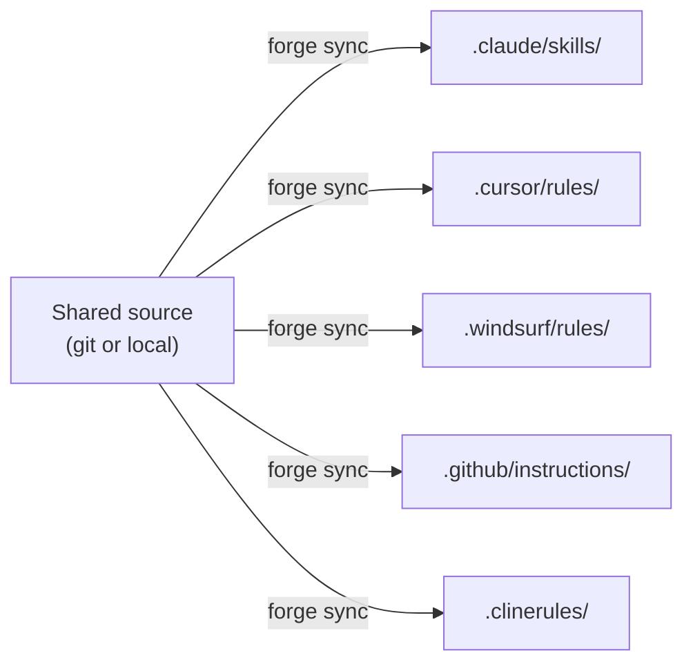
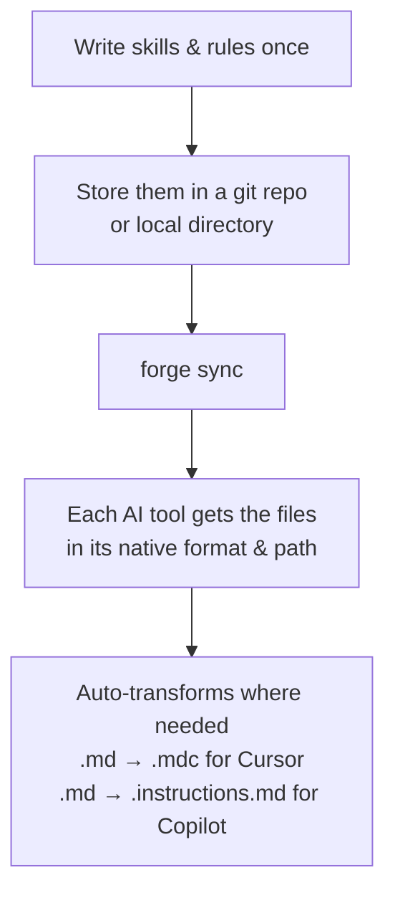

# Forge CLI

<!-- TODO: badges (version, tests, license, downloads) -->

Your team uses Claude Code, Cursor, Windsurf, Copilot, and Cline. Maybe all of them. Maybe different ones per repo.

Each tool has its own config format, its own folder structure, its own way of doing things. So what happens? Someone writes a great deployment skill for Claude Code, and it lives in `.claude/skills/deploy.md`. The Cursor folks never see it. The Copilot people have their own version that's three weeks out of date.

10 repos, 5 AI tools, 50 config files. Copy-paste. Drift. Nobody knows what's actually current.

**Forge fixes that.**

One shared source of skills, rules, and workflows. One command to sync them everywhere, in the right format, in the right place.



## Install

```bash
# bun (recommended)
bun add -g @crucibledx/forge-cli

# npm
npm install -g @crucibledx/forge-cli
```

Requires [Bun](https://bun.sh) v1.3+ or Node.js 20+.

## Quick Start

Three commands. That's it.

```bash
forge init    # detects your AI tools, picks a source
forge sync    # pulls files, places them where each tool expects
forge health  # shows what's synced, what drifted, what's broken
```

Forge writes config to `.crucible/forge.config.yaml`. Commit it so the whole team stays in sync.

## How It Works



You define your shared configs in a structured source:

```
my-source/
  skills/
    deploy.md
    testing.md
  rules/
    code-style.md
  workflows/
    review.md
```

Forge figures out the layout automatically and maps each file to the right target path for each assistant.

## Supported AI Tools

| Tool               | Where files land                                                             |
|--------------------|------------------------------------------------------------------------------|
| **Claude Code**    | `.claude/skills/`, `.claude/rules/`, `.claude/commands/`                     |
| **Cursor**         | `.cursor/rules/` (auto `.md` → `.mdc` transform)                             |
| **Windsurf**       | `.windsurf/rules/`, `.windsurf/workflows/`                                   |
| **GitHub Copilot** | `.github/skills/`, `.github/instructions/` (auto `.md` → `.instructions.md`) |
| **Cline**          | `.cline/skills/`, `.clinerules/`, `.clinerules/workflows/`                   |

Forge auto-detects which tools are active in your project. If you don't use Windsurf, it won't touch `.windsurf/`.

More tools coming. It's pluggable - adding a new assistant is one file.

## Commands

| Command                     | What it does                                         |
|-----------------------------|------------------------------------------------------|
| `forge init`                | Interactive setup - detect tools, configure sources  |
| `forge sync`                | Fetch from sources, place files for each tool        |
| `forge sync --dry-run`      | Preview changes without writing anything             |
| `forge status`              | Show drift between last sync and current filesystem  |
| `forge health`              | Dashboard - sync status, drift, sources, recent logs |
| `forge config`              | Edit project configuration interactively             |
| `forge source list`         | Show configured sources with sync file counts        |
| `forge source add`          | Add a new source interactively                       |
| `forge source remove`       | Remove a source, optionally clean synced files       |
| `forge scheduler install`   | Register an OS-level auto-sync task                  |
| `forge scheduler uninstall` | Remove the scheduled sync task                       |
| `forge scheduler status`    | Show next run time and scheduler status              |

## Sources

### Local directory

Point to a folder on disk. Works great for monorepos or local development:

```yaml
sources:
  - name: team-rules
    type: local
    path: ../shared-ai-configs
```

### Git repository

Pull from any remote, SSH or HTTPS:

```yaml
sources:
  - name: org-standards
    type: git
    url: git@github.com:acme/ai-configs.git
    branch: main
```

### Source layouts

Forge auto-detects how your source is organized:

- **`canonical`** - flat files at root, distributed by name matching
- **`skills`** - pre-structured with `skills/`, `rules/`, `workflows/` folders
- **`hybrid`** - mix of both

No config needed. Just organize your files and Forge figures it out.

## Config

Generated by `forge init` at `.crucible/forge.config.yaml`:

```yaml
version: "1"
assistants:
  - id: claude-code
    enabled: true
  - id: cursor
    enabled: true
sources:
  - name: team-rules
    type: local
    path: ../shared-ai-configs
sync:
  source_conflict_strategy: prefer_source
  local_conflict_strategy: overwrite
  backup: true
```

Global config lives at `~/.crucible/forge.config.yaml` (use `--global` flag).

## Auto-Sync

Set up OS-level scheduling so syncs happen automatically. Launchd on macOS, systemd on Linux.

```bash
forge scheduler install    # registers a cron-style task
forge scheduler status     # check next run time
forge scheduler uninstall  # remove it
```

Configure the schedule in your config:

```yaml
sync:
  schedule: "0 9 * * *"   # daily at 9am
```

## Development

```bash
bun install               # install deps
bun run dev -- <command>  # run locally
bun run test              # unit + e2e tests
bun run typecheck         # tsc --noEmit
bun run format            # prettier
bun run lint:fix          # eslint
bun run build             # compile to single binary
```

### Architecture

DDD with three layers:

- **`domain/`** - pure types, logic, schemas. No I/O.
- **`application/`** - command handlers that orchestrate everything
- **`infrastructure/`** - all I/O: filesystem, git, CLI, config parsing

Adding a new assistant or source type is one file in the right folder. No changes to existing commands.

## License

TBD
