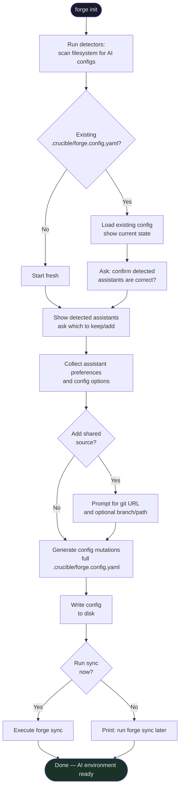
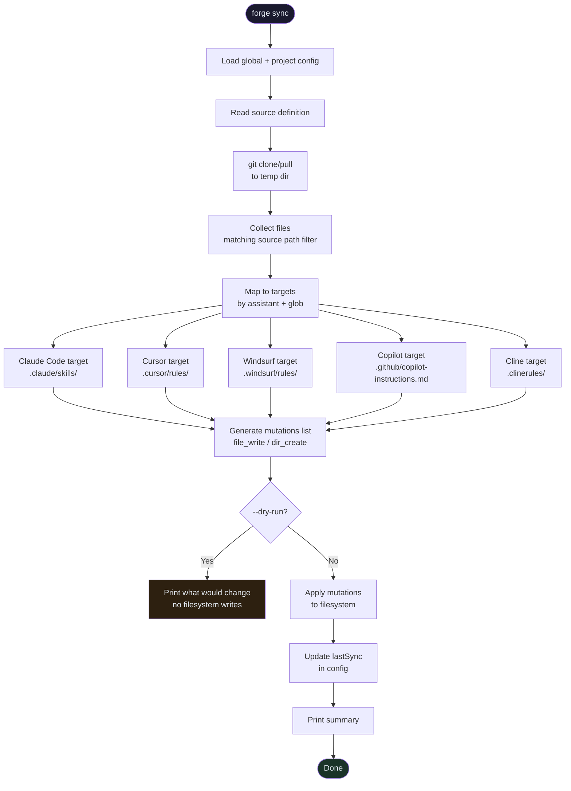

# Forge CLI — v0.1 Architecture & Design

> **Milestone:** Forge v0.1 — the first shippable product under the Crucible brand.
>
> **Scope:** Bootstrap (init AI environment) + Sync (fetch shared skills from **one** source).
>
> **Binary:** `forge` — installed via `@crucible/forge-cli` on npm.
>
> **Later:** This CLI becomes the foundation. When forge core (plugin discovery) ships, the internals change but the
> command stays `forge init`, `forge sync` — users notice nothing.

---

## Naming Convention

| Layer                | Name                  | Example                                          |
|----------------------|-----------------------|--------------------------------------------------|
| **Brand**            | Crucible              | Like Anthropic                                   |
| **Product**          | Forge                 | Like Claude — the AI dev environment CLI         |
| **npm package**      | `@crucible/forge-cli` | `npm install -g @crucible/forge-cli`             |
| **Binary**           | `forge`               | What users type in terminal                      |
| **Config directory** | `.crucible/`          | Brand-level — shared by future Crucible products |

When forge core (plugin system) arrives, bootstrap becomes a built-in plugin. Users still type `forge init` — the
migration is invisible.

---

## What This CLI Does (v0.1)

Two commands, one binary, one config file:

| Command      | What it solves                                                 |
|--------------|----------------------------------------------------------------|
| `forge init` | Initialize AI assistant config in a new project (bootstrap)    |
| `forge sync` | Fetch shared skills & workflows from **one** remote git source |

Both share the same config, same binary, same install. One story: *"Set up and maintain your team's AI environment with
one tool."*

---

## v0.1 Milestone

- `forge init` wizard — detects existing AI configs, writes `.crucible/forge.config.yaml`
- `forge sync` — pulls from **one** git source (SSH or HTTPS), places files in correct assistant paths
- Supports: Claude Code, Cursor, Windsurf, GitHub Copilot, Cline
- Single binary via `bun build --compile` — no runtime dependency
- Works with GitHub, GitLab, Azure DevOps (any git SSH/HTTPS URL)
- `forge sync --dry-run` — preview what would change without writing

**Not in v0.1** (see forge-v0.2.md):

- Multiple sources with merge/conflict resolution
- Scheduler (automatic sync)
- `forge status` (drift detection)
- `forge update` (re-apply after config changes)
- Plugin protocol implementation

---

## Config File: `.crucible/forge.config.yaml`

One file. Sections will be owned by different plugins later. For v0.1, only `assistants` and one `source` matter.

```yaml
# .crucible/forge.config.yaml
# Schema version — enables clean migrations
version: "1"

# ── Project metadata (optional) ────────────────────────────────
project:
  name: my-api-service          # defaults to directory name
  description: "Backend API"

# ── AI Assistants ───────────────────────────────────────────────
# Detected automatically on `forge init`, or specified manually
assistants:
  - id: claude-code
    enabled: true
    config:
      skills_dir: .claude/skills
      settings:
        permissions:
          allow:
            - "Bash(npm run *)"
            - "Bash(git *)"
            - "Bash(docker *)"
          deny:
            - "Read(.env)"
            - "Read(.env.*)"

  - id: cursor
    enabled: true
    config:
      rules_dir: .cursor/rules

  - id: windsurf
    enabled: true
    config:
      rules_dir: .windsurf/rules

  - id: copilot
    enabled: false             # detected, consciously skipped
    config:
      instructions_file: .github/copilot-instructions.md

  - id: cline
    enabled: false
    config:
      rules_dir: .clinerules

# ── Source (v0.1: single source only) ──────────────────────────
source:
  name: team-shared
  type: git
  url: git@github.com:acme/ai-configs.git
  branch: main
  # Subdirectory inside the source repo (optional, default: root)
  path: skills/

# ── Future sections (reserved, empty in v0.1) ─────────────────
# sources: []         # v0.2: multiple sources with merge
# sync: {}            # v0.2: conflict strategy, scheduler
# plugins: []         # v0.3: plugin registry
```

### Global Config: `~/.crucible/forge.config.yaml`

```yaml
version: "1"

user:
  name: "Alex"

# Defaults for every project — project config inherits and overrides
defaults:
  assistants:
    - id: claude-code
      enabled: true
    - id: cursor
      enabled: true

  # Default source for all projects
  source:
    name: company-wide
    type: git
    url: git@github.com:acme/ai-configs.git
    branch: main
```

---

## Plugin Protocol (Defined Now, Used Later)

Defined now so the CLI's internal structure aligns with the future plugin system. Not implemented in v0.1 — the CLI
reads config from disk directly. When forge core arrives, it sends this via stdin instead.

### Request (core → plugin, via stdin)

```typescript
interface PluginRequest {
    version: "1"
    command: string               // "init", "sync", etc. — extensible
    subcommand?: string
    args: string[]
    flags: Record<string, unknown>
    context: {
        globalConfig: CrucibleConfig | null
        projectConfig: CrucibleConfig | null
        projectRoot: string         // absolute path
        crucibleDir: string         // ~/.crucible absolute path
        isInteractive: boolean      // false in CI
        dryRun: boolean
    }
}
```

### Response (plugin → core, via stdout)

```typescript
interface PluginResponse {
    version: "1"
    status: "success" | "error" | "partial"

    // Human-readable output — core handles rendering
    output: Array<{
        level: "info" | "warn" | "error" | "debug" | "success"
        message: string
        detail?: string
    }>

    // Filesystem changes — core applies these
    // Plugin never writes files directly
    mutations: Array<
        | { type: "file_write"; path: string; content: string }
        | { type: "file_delete"; path: string }
        | { type: "dir_create"; path: string }
        | { type: "symlink_create"; path: string; target: string }
    >

    // Config changes to propose back
    configUpdates: Array<{
        scope: "project" | "global"
        path: string              // dot notation: "assistants.0.enabled"
        value: unknown
        reason: string
    }>

    // Wizard prompts for interactive flows
    prompts?: Array<{
        id: string
        type: "select" | "multiselect" | "text" | "confirm"
        message: string
        choices?: Array<{ value: string; label: string; hint?: string }>
        default?: unknown
    }>

    error?: {
        code: string
        message: string
        recoverable: boolean
        suggestion?: string
    }
}
```

---

## Internal Architecture (v0.1) — Domain-Driven Design

Three layers with strict dependency direction: **domain ← application ← infrastructure**.
Domain has zero I/O dependencies. Application orchestrates domain + infrastructure. Infrastructure handles all I/O.

```
forge-cli/
  src/
    main.ts                          # entrypoint: parse args, detect mode, route

    ─── domain/ ──────────────────── # pure business logic, no I/O

    domain/
      assistants/                    # each AI assistant as a domain entity
        claude-code.ts               # detection rules, target paths, config shape
        cursor.ts
        windsurf.ts
        copilot.ts
        cline.ts
        registry.ts                  # assistant lookup by id, list all
        types.ts                     # AssistantId, AssistantConfig, TargetMapping

      config/
        schema.ts                    # Zod schemas for config validation
        merge.ts                     # global + project config merge logic
        types.ts                     # CrucibleConfig, ForgeConfig types

      sync/
        resolver.ts                  # map source files → target destinations per assistant
        types.ts                     # Mutation, SyncPlan, SyncResult

      protocol/
        types.ts                     # PluginRequest, PluginResponse (defined now, used later)

    ─── application/ ─────────────── # use cases / command handlers

    application/
      init.command.ts                # wizard flow: detect → prompt → emit config mutations
      sync.command.ts                # fetch source → resolve targets → emit file mutations

    ─── infrastructure/ ──────────── # all I/O: filesystem, git, terminal, stdin/stdout

    infrastructure/
      fs/
        mutations.ts                 # applies mutation list to filesystem
        rollback.ts                  # undo mutations on error
        scanner.ts                   # scan filesystem for existing AI config dirs/files

      git/
        client.ts                    # git clone/pull to temp dir

      config/
        loader.ts                    # read .crucible/forge.config.yaml from disk
        writer.ts                    # write config back to disk

      io/
        standalone.ts                # standalone mode: disk config → command → apply mutations
        plugin.ts                    # plugin mode: stdin/stdout (stub in v0.1)

      cli/
        parser.ts                    # argument parsing (e.g. commander / yargs)
        renderer.ts                  # terminal output rendering (colors, tables)
        prompts.ts                   # interactive terminal prompts (clack)
```

### Layer Rules

- **`domain/`** — pure functions and types. No `fs`, no `child_process`, no `stdin`. Testable in isolation.
- **`application/`** — command handlers. Receive domain types as input, emit `Mutation[]`, `ConfigUpdate[]`, `Prompt[]`
  as output. Never touch the filesystem directly.
- **`infrastructure/`** — all side effects. Reads disk, calls git, renders terminal, applies mutations. The
  `io/standalone.ts` ↔ `io/plugin.ts` boundary is the entire migration path to plugin mode later.

---

## Commands Design

### `forge init`

```
$ forge init

  ┌─────────────────────────────────────────────┐
  │  Forge — AI Environment Setup               │
  └─────────────────────────────────────────────┘

  Scanning for existing AI configs...

  Detected:
  ✓ Claude Code   (.claude/ directory found)
  ✓ Cursor        (.cursor/rules/ found, 3 rules)
  ○ Windsurf      (not detected)
  ○ Copilot       (not detected)

  Keep Claude Code? ›  Yes
  Keep Cursor?      ›  Yes
  Add Windsurf?     ›  No
  Add Copilot?      ›  No

  Claude Code permissions — allow npm/git/docker? ›  Yes

  Add a shared skills source? ›  Yes
  Source git URL (SSH or HTTPS):
  ›  git@github.com:acme/ai-configs.git

  ✓ Config written to .crucible/forge.config.yaml
  
  Run `forge sync` to fetch shared skills now.
```

### `forge sync`

```
$ forge sync

  Syncing from source: team-shared
  Pulling git@github.com:acme/ai-configs.git (branch: main)...

  Claude Code:
  ✓  .claude/skills/code-review.md       (new)
  ✓  .claude/skills/deploy.md            (new)
  ✓  .claude/skills/testing.md           (new)

  Cursor:
  ✓  .cursor/rules/typescript.mdc        (new)
  ✓  .cursor/rules/backend.mdc           (new)

  Done. 5 files synced from team-shared.
  Last sync: 2026-04-18 14:32
```

### `forge sync --dry-run`

```
$ forge sync --dry-run

  Would sync from source: team-shared
  + .claude/skills/code-review.md       (new)
  + .claude/skills/deploy.md            (new)
  ~ .cursor/rules/typescript.mdc        (update)
  = .cursor/rules/backend.mdc           (no change)

  Run without --dry-run to apply.
```

---

## Bootstrap Flow



---

## Sync Flow (v0.1 — Single Source)



---

## Source Types (v0.1)

### Git (SSH + HTTPS)

```typescript
interface GitSource {
    type: "git"
    url: string          // any git URL: github, gitlab, azure devops, self-hosted
    branch: string       // default: "main"
    path?: string        // subdirectory within repo (default: root)
    auth?: {
        type: "ssh-key" | "token"
        keyPath?: string   // for SSH, default: ~/.ssh/id_rsa
        token?: string     // for HTTPS + PAT (read from env var)
    }
}
```

SSH key auth works automatically if `~/.ssh` is configured. No extra setup.

HTTPS + PAT: read from `FORGE_GIT_TOKEN` env var or OS keychain. Never stored in config.

### Local

```typescript
interface LocalSource {
    type: "local"
    path: string         // absolute or ~ path
}
```

---

## Target Auto-Resolution

If the user doesn't specify explicit target mappings, files are placed automatically based on enabled assistants.
Paths are based on the [AI config research](../ai-config-research.md).

### Source repo structure (recommended)

A shared repo organizes by semantic type — the source doesn't need to know which AI assistant the consumer uses:

```
team-ai-configs/
  skills/              # SKILL.md format (Agent Skills open standard)
    deploy/SKILL.md
    code-review/SKILL.md
  rules/               # plain Markdown (no frontmatter = maximum compatibility)
    typescript.md
    testing.md
  workflows/           # plain Markdown, slash-command invoked
    pr-review.md
    release.md
```

### Auto-target mapping

```typescript
const AUTO_TARGETS: Record<AssistantId, TargetMapping[]> = {
    // Skills: all tools use Agent Skills open standard (SKILL.md)
    // Rules: each tool has its own path + extension
    // Workflows: plain Markdown, paths differ per tool

    "claude-code": [
        {sourceGlob: "skills/**", destination: ".claude/skills/"},
        {sourceGlob: "rules/**", destination: ".claude/rules/"},
        {sourceGlob: "workflows/**", destination: ".claude/commands/"},
    ],
    "windsurf": [
        {sourceGlob: "skills/**", destination: ".windsurf/skills/"},
        {sourceGlob: "rules/**", destination: ".windsurf/rules/"},
        {sourceGlob: "workflows/**", destination: ".windsurf/workflows/"},
    ],
    "cursor": [
        {sourceGlob: "skills/**", destination: ".cursor/skills/"},
        {sourceGlob: "rules/**", destination: ".cursor/rules/", transform: "rename:.md→.mdc"},
        {sourceGlob: "workflows/**", destination: ".cursor/commands/"},
    ],
    "copilot": [
        {sourceGlob: "skills/**", destination: ".github/skills/"},
        // Copilot rules: .github/copilot-instructions.md (single file, always-on)
        // + .github/instructions/*.instructions.md (path-scoped)
        // v0.1: copy rules as separate .instructions.md files
        {sourceGlob: "rules/**", destination: ".github/instructions/", transform: "rename:.md→.instructions.md"},
    ],
    "cline": [
        {sourceGlob: "skills/**", destination: ".cline/skills/"},
        {sourceGlob: "rules/**", destination: ".clinerules/"},
        {sourceGlob: "workflows/**", destination: ".clinerules/workflows/"},
    ],
}
```

### Key research findings applied

- **Skills** — highest cross-tool compatibility. All tools use the Agent Skills open standard (`SKILL.md` + YAML
  frontmatter with `name`/`description`). Paths differ but format is identical.
- **Rules** — partial compatibility. Content (plain Markdown) is portable. YAML frontmatter keys differ:
  `paths` (Claude Code, Cline), `globs` (Cursor, Windsurf), `applyTo` (Copilot). v0.1 syncs plain Markdown
  (no frontmatter) for maximum compatibility. Frontmatter translation deferred to v0.2.
- **Workflows** — compatible for Windsurf/Cursor/Claude Code/Cline (all plain Markdown, slash-command invoked).
  Copilot has no native workflow equivalent.
- **Cursor rules need `.mdc` extension** — a `transform` step renames `.md` → `.mdc` during sync.
- **Copilot instructions need `.instructions.md` suffix** — same transform approach.

### Known limitations (v0.1)

- **No frontmatter translation** — rules are synced as plain Markdown. Path-scoped rules require manual
  frontmatter per tool. Translation layer (`paths` ↔ `globs` ↔ `applyTo`) is v0.2.
- **Copilot single-file**: `.github/copilot-instructions.md` (the always-on file) is not auto-generated from
  multiple rule files. Users who want this must create it manually or wait for v0.2 concatenation support.
- **Transform steps** (`rename:.md→.mdc`) are simple filename transforms only. No content transformation in v0.1.

---

## How This Becomes a Plugin

In standalone mode today:

```
main.ts → reads config from disk → routes to command → applies mutations
```

When forge core (plugin discovery system) exists:

```
forge core → spawns this as subprocess → sends PluginRequest via stdin
           ← receives PluginResponse via stdout ← applies mutations
```

The single change: `main.ts` checks for `--plugin-mode` flag and reads from stdin instead of disk. Command handlers,
mutation logic, and wizard prompts don't change at all.

The `io/standalone.ts` ↔ `io/plugin.ts` boundary is the entire migration path.

---

## Distribution

Single binary, no runtime required:

```bash
# Install via npm (recommended)
npm install -g @crucible/forge-cli

# Or via curl (for CI/CD)
curl -fsSL https://get.crucible.dev/forge | sh

# Or via brew (macOS)
brew install crucible/tap/forge
```

Built with `bun build --compile` — produces a native binary for macOS, Linux, Windows.

---

## Open Questions for v0.1

- [x] **Windsurf paths:** Confirmed via [research](../ai-config-research.md):
  skills in `.windsurf/skills/<name>/SKILL.md`, rules in `.windsurf/rules/*.md`,
  workflows in `.windsurf/workflows/*.md`
- [x] **Copilot single-file:** v0.1 syncs rules as individual `.instructions.md` files into `.github/instructions/`.
  The always-on `.github/copilot-instructions.md` concatenation is deferred to v0.2.
- [ ] **Config in `.gitignore`?** `.crucible/forge.config.yaml` should be committed (team shares it).
  `.crucible/forge.config.local.yaml` for personal overrides (gitignored). See v0.2 for config promotion
  workflow (`local → project → global` via CLI commands).

---

*Document version: 0.1 — pre-implementation*

*Scope: forge v0.1 only — see forge-v0.2.md for next milestone*
