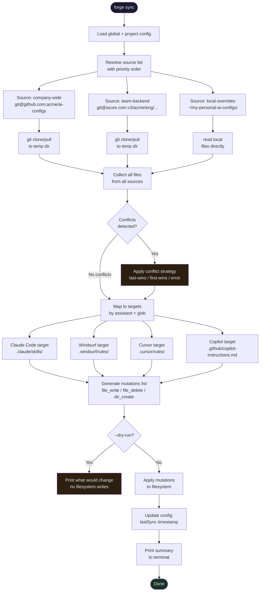

# Forge CLI — v0.2 Architecture & Design

> **Milestone:** Forge v0.2 — "Solid"
>
> **Prerequisite:** Forge v0.1 shipped, users providing feedback.
>
> **Scope:** Multi-source with merge, drift detection, scheduler, re-apply.

---

## New Commands

| Command        | What it solves                                        |
|----------------|-------------------------------------------------------|
| `forge status` | Show drift between config and what's actually on disk |
| `forge update` | Re-apply config after changes (detect + diff + apply) |

Combined with v0.1 commands (`forge init`, `forge sync`), the full CLI surface is now complete for the standalone phase.

---

## What Changes From v0.1

### Config: Multiple Sources + Sync Behavior

The `source:` field (singular) from v0.1 becomes `sources:` (plural) with priority and conflict strategy:

```yaml
# .crucible/config.yaml additions for v0.2

# ── Sources (replaces v0.1 singular `source:`) ──────────────────
sources:
  - name: company-wide
    type: git
    url: git@github.com:acme/ai-configs.git
    branch: main
    path: skills/

  - name: team-backend
    type: git
    url: git@ssh.dev.azure.com:v3/acme/eng/backend-team-ai.git
    branch: main
    path: shared/

  - name: local-overrides
    type: local
    path: ~/my-personal-ai-configs/
    # Local sources are always highest priority in merge

# ── Explicit target mappings (optional) ─────────────────────────
# If omitted, auto-resolved from `assistants` section (same as v0.1)
targets:
  - assistant: claude-code
    source_glob: "skills/**"
    destination: .claude/skills/

  - assistant: windsurf
    source_glob: "skills/**"
    destination: .windsurf/rules/

  - assistant: cursor
    source_glob: "rules/**"
    destination: .cursor/rules/

# ── Sync behavior ───────────────────────────────────────────────
sync:
  # Strategy when same file exists in multiple sources
  # "last-wins" | "first-wins" | "error"
  conflict_strategy: last-wins

  # Source priority for conflict resolution (highest first)
  source_priority:
    - local-overrides
    - team-backend
    - company-wide

  # Auto-sync schedule (cron expression)
  # null = manual only
  schedule: "0 9 * * 1"        # Every Monday at 9am

  # Keep local files not present in source
  keep_local: true
```

### Migration from v0.1

The v0.1 `source:` (singular) config is auto-migrated: if `source:` exists and `sources:` does not, the CLI wraps it
into a single-element `sources:` array. No user action needed.

---

## New Commands Design

### `forge status`

```
$ forge status

  Config: .crucible/config.yaml  ✓

  Claude Code    ✓ in sync (3 skills)
  Windsurf       ⚠ 1 file missing
                   .windsurf/rules/deploy.md (in config, not on disk)
  Cursor         ✓ in sync (2 rules)

  Last sync: 2 days ago
  Run `forge sync` to update.
```

### `forge update`

```
$ forge update

  Scanning for changes...

  Config changed since last apply:
  + Windsurf added (was disabled)
  ~ Claude Code permissions updated

  Applying changes...
  ✓ Created .windsurf/rules/
  ✓ Updated .claude/settings.json

  Done. 2 changes applied.
```

---

## Multi-Source Sync (Updated `forge sync`)

```
$ forge sync

  Syncing from 2 sources...

  [company-wide]  Pulling git@github.com:acme/ai-configs.git...
  [team-backend]  Pulling git@ssh.dev.azure.com:v3/acme/eng/...

  Merging (strategy: last-wins, priority: team-backend > company-wide)

  Claude Code:
  ✓  .claude/skills/code-review.md       (company-wide)
  ✓  .claude/skills/deploy.md            (team-backend)
  ✓  .claude/skills/testing.md           (team-backend)
  →  .claude/skills/api-patterns.md      conflict resolved (team-backend wins)

  Cursor:
  ✓  .cursor/rules/typescript.mdc        (company-wide)
  ✓  .cursor/rules/backend.mdc           (team-backend)

  Done. 6 files synced, 1 conflict resolved.
  Last sync: 2026-04-18 14:32
```

---

## Multi-Source Fetch & Merge Flow



---

## Internal Architecture Additions

New modules added on top of v0.1 structure:

```
forge-cli/
  src/
    commands/
      status.ts              # diff config vs filesystem — report drift
      update.ts              # detect + diff + apply with confirmation
    
    merge/
      engine.ts              # merge files from multiple sources
      strategy.ts            # last-wins, first-wins, error strategies
      conflict.ts            # detect and report conflicts
    
    scheduler/
      cron.ts                # parse cron expressions, run sync on schedule
      daemon.ts              # background process management
```

---

## Merge Engine Design

### Conflict Detection

A conflict occurs when the same relative file path exists in two or more sources. Example:

- `company-wide` has `skills/deploy.md`
- `team-backend` has `skills/deploy.md`

### Resolution Strategies

| Strategy     | Behavior                                                       |
|--------------|----------------------------------------------------------------|
| `last-wins`  | Source with highest priority wins (per `source_priority` list) |
| `first-wins` | Source with lowest priority wins (first encountered)           |
| `error`      | Fail and report — user must resolve manually                   |

### Source Priority

Defined in `sync.source_priority`. Sources listed first have highest priority. Sources not in the list get lowest
priority (alphabetical fallback).

Local sources (`type: local`) are always treated as highest priority regardless of the list — a dev's local overrides
should always win.

---

## Scheduler

Runs `forge sync` automatically on a schedule defined in config:

```yaml
sync:
  schedule: "0 9 * * 1"   # cron: every Monday 9am
```

Implementation options (TBD):

- **OS-level cron/launchd** — `forge scheduler install` writes a crontab entry or launchd plist
- **Background daemon** — `forge scheduler start` runs a long-lived process (heavier, more control)

Recommended: OS-level integration. Lighter, survives reboots, no daemon management.

---

## Config Promotion Workflow

Config changes should be manageable via CLI, not just manual YAML editing. The idea: changes start local, then can be
promoted upward.

### Three config layers

| Layer       | File                                | Shared?                                |
|-------------|-------------------------------------|----------------------------------------|
| **Local**   | `.crucible/forge.config.local.yaml` | No (gitignored) — personal overrides   |
| **Project** | `.crucible/forge.config.yaml`       | Yes (committed) — team config          |
| **Global**  | `~/.crucible/forge.config.yaml`     | No — user defaults across all projects |

### CLI commands for config management

```bash
# Change a source URL (saved to local config first)
forge config set source.url git@github.com:acme/new-repo.git

# Promote a local change to project config (team-visible)
forge config promote --to project source.url

# Promote a project setting to global (applies to all projects)
forge config promote --to global defaults.assistants

# View effective config (merged: global + project + local)
forge config show

# View what's different between layers
forge config diff
```

### Identification

When a config section has multiple items (e.g., 10 sources), the CLI identifies by `name`:

```bash
forge config set sources.team-backend.branch develop
# ↑ identifies source by name "team-backend", changes its branch
```

### DX goal

Users never *have* to edit YAML manually. The CLI wizard (`forge init`) handles initial setup,
`forge config set/promote` handles ongoing changes. YAML files exist for power users and version control review.

---

## Rules Frontmatter Translation (v0.2)

v0.1 syncs rules as plain Markdown (no frontmatter). v0.2 adds a translation layer for path-scoped rules:

```yaml
# Source rule (canonical format uses `paths` — same as Claude Code/Cline)
---
paths:
  - "src/api/**/*.ts"
---
All endpoints must include input validation.
```

Translation during sync:

| Target      | Frontmatter key | Transform                                         |
|-------------|-----------------|---------------------------------------------------|
| Claude Code | `paths`         | No change (canonical)                             |
| Cline       | `paths`         | No change                                         |
| Windsurf    | `globs`         | Rename key                                        |
| Cursor      | `globs`         | Rename key + `.md` → `.mdc` extension             |
| Copilot     | `applyTo`       | Rename key + `.md` → `.instructions.md` extension |

---

## v0.3 Preview (Plugin-Ready)

- Internal plugin protocol activated (`--plugin-mode` flag)
- `forge` binary can be spawned by forge core as a subprocess
- Plugin manifest defined for this CLI
- Ready to be hosted by the forge core plugin discovery system

---

*Document version: 0.2 — pre-implementation*
*Prerequisite: forge v0.1 shipped*
*Scope: multi-source, merge, scheduler, status, update*
