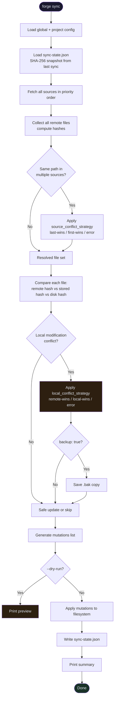

# Forge CLI — v0.3 Architecture & Design

> **Milestone:** Forge v0.3 — "Sync Solid"
>
> **Prerequisite:** Forge v0.2 shipped (config management, multi-source init).
>
> **Scope:** Enhanced sync with merge engine, change-detection via SHA-256,
> `forge status` drift detection, backup support, local-vs-remote conflict strategy.

---

## New Commands

| Command        | What it solves                                            |
|----------------|-----------------------------------------------------------|
| `forge status` | Show drift between last sync state and current disk state |

Combined with v0.2 (`forge init`, `forge sync`, `forge update`, `forge config`),
the full standalone CLI surface is complete.

---

## What Changes From v0.2

### Config: Sync Behavior Block

```yaml
# .crucible/forge.config.yaml — v0.3 additions

sync:
  # Strategy when the same relative path exists in multiple sources
  # "last-wins" | "first-wins" | "error"
  source_conflict_strategy: last-wins

  # Strategy when a file was modified locally AND updated remotely since last sync
  # "remote-wins" | "local-wins" | "error"
  local_conflict_strategy: remote-wins

  # Save a .bak copy before overwriting a locally modified file
  backup: true

  # Keep local files not present in any source (don't delete them)
  keep_local: true
```

Two distinct conflict axes:
- **Multi-source conflict** — same file in `company-wide` and `team-backend` →
  resolved by `source_conflict_strategy` + `sources` order.
- **Local modification conflict** — file was synced before, user edited it locally,
  AND the remote also changed since last sync →
  resolved by `local_conflict_strategy`.

---

## Change Detection via SHA-256

Forge stores a state snapshot after each sync:

```json
// .crucible/sync-state.json
{
  "lastSync": "2026-05-05T14:32:00Z",
  "files": {
    ".claude/skills/deploy.md": "sha256:abc123...",
    ".cursor/rules/typescript.mdc": "sha256:def456..."
  }
}
```

On the next sync, for each file:
1. Compare current disk hash vs stored hash → **locally modified?**
2. Compare new remote hash vs stored hash → **remotely updated?**
3. If both changed → **conflict** → apply `local_conflict_strategy`
4. If only remote changed → update (always safe)
5. If only local changed → skip if `keep_local: true`, or apply strategy

This works for any source type (git, local, CDN) — no git-diff dependency.

---

## `forge status`

Shows drift between the last sync state and the current filesystem:

```
$ forge status

  Config: .crucible/forge.config.yaml  ✓
  Last sync: 2 days ago

  Claude Code
  ↓  .claude/skills/deploy.md          (remote updated — will overwrite)
  ✗  .claude/skills/code-review.md     (locally modified — conflict)
  +  .claude/skills/new-feature.md     (new in source)
  -  .claude/skills/old-api.md         (deleted in source)

  Cursor
  ✓  .cursor/rules/typescript.mdc      (in sync)

  Run `forge sync` to apply changes.
  Run `forge sync --dry-run` to preview exact mutations.
```

Legend:
- `↓` remote updated, local unchanged → will overwrite
- `✗` both sides changed → conflict, resolved by `local_conflict_strategy`
- `+` new file in source → will be added
- `-` deleted in source → will be removed (unless `keep_local: true`)
- `✓` in sync

---

## Updated `forge sync` Output

```
$ forge sync

  Syncing from 2 sources...

  [company-wide]  Pulling git@github.com:acme/ai-configs.git...
  [team-backend]  Pulling git@ssh.dev.azure.com:v3/acme/eng/...

  Merging (source strategy: last-wins, local strategy: remote-wins)

  Claude Code:
  ✓  .claude/skills/code-review.md       (company-wide — new)
  ✓  .claude/skills/deploy.md            (team-backend — updated)
  →  .claude/skills/api-patterns.md      (conflict — remote wins, .bak saved)

  Cursor:
  ✓  .cursor/rules/typescript.mdc        (company-wide — no change)
  ✓  .cursor/rules/backend.mdc           (team-backend — new)

  Done. 5 files synced, 1 conflict resolved (remote-wins).
  Last sync: 2026-05-05 14:32
```

---

## Multi-Source Merge Flow



---

## Internal Architecture Additions

```
forge-cli/
  src/
    application/commands/
      status/index.ts + handler.ts    # diff sync-state vs disk

    domain/
      sync/
        state.ts                      # SyncState type, hash helpers
        conflict.ts                   # conflict detection logic (pure)
        merge.ts                      # merge files from multiple sources (pure)

    infrastructure/
      sync/
        state.ts                      # read/write .crucible/sync-state.json
        strategies.ts                 # last-wins, first-wins, remote-wins, local-wins
```

---

## Rules Frontmatter Translation (carried from v0.2)

Path-scoped rules get frontmatter keys translated during sync:

| Target      | Frontmatter key | Transform                                         |
|-------------|-----------------|---------------------------------------------------|
| Claude Code | `paths`         | No change (canonical)                             |
| Cline       | `paths`         | No change                                         |
| Windsurf    | `globs`         | Rename key                                        |
| Cursor      | `globs`         | Rename key + `.md` → `.mdc` extension             |
| Copilot     | `applyTo`       | Rename key + `.md` → `.instructions.md` extension |

---

*Document version: 0.3 — pre-implementation*
*Prerequisite: forge v0.2 shipped*
*Scope: sync v2, merge engine, SHA-256 state, forge status, backup, conflict strategies*
*Next: see forge-v0.4.md (scheduler)*
